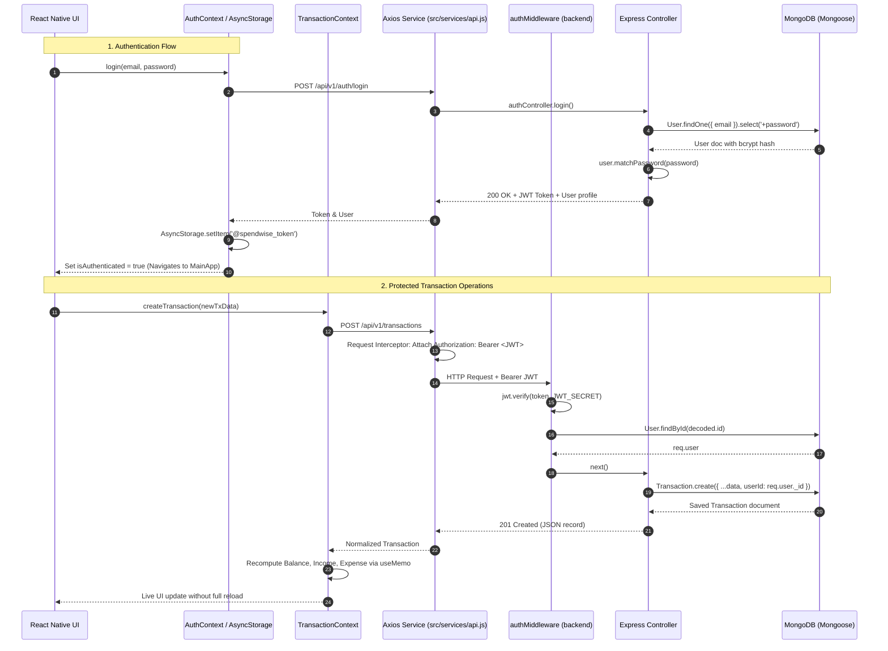

# SpendWise – Project Architecture

This document describes the architectural layout, directory responsibilities, component hierarchy, navigation design, and design philosophies of **SpendWise – Personal Expense Tracker**.

---

## 1. Directory Structure

```text
SpendWise/
│
├── assets/                  # Static assets: images, app icons, and fonts
│   ├── images/
│   ├── icons/
│   └── fonts/
│
├── src/                     # Application source code
│   ├── components/          # Reusable UI components (Button, Input, Card, etc.)
│   ├── screens/             # Screen components (Login, Register, ForgotPassword)
│   ├── navigation/          # React Navigation navigators (AuthNavigator, AppNavigator)
│   ├── services/            # API services and networking (Future phases)
│   ├── context/             # Global React Context providers (Auth, Expense) (Future phases)
│   ├── hooks/               # Custom React hooks (Future phases)
│   ├── constants/           # App-wide constants (routes, strings)
│   ├── utils/               # Helper and validation utilities
│   └── styles/              # Theme, colors, typography, and global styles
│
├── docs/                    # Architectural, phase tracking, and viva notes
│   ├── DEVELOPMENT_NOTES.md
│   ├── PROJECT_ARCHITECTURE.md
│   └── PHASE_TRACKER.md
│
├── App.js                   # Root entry point initializing navigation and providers
├── app.json                 # Expo configuration (app metadata, icons, orientation)
├── package.json             # NPM project manifest & dependencies
└── .gitignore               # Git ignored directories (node_modules, .expo, etc.)
```

---

## 2. Directory Responsibilities

| Directory | Purpose & Responsibility |
|---|---|
| `assets/` | Holds static images, splash screens, vector icons, and custom fonts. |
| `src/components/` | Reusable presentational components (dumb/pure components) that receive props and trigger callbacks without direct coupling to business logic. |
| `src/screens/` | Full-screen components representing pages in the application stack (e.g., `LoginScreen`, `RegisterScreen`, `ForgotPasswordScreen`). Responsible for screen-level state and form handling. |
| `src/navigation/` | Configures React Navigation stack, tab, and drawer navigators, defining route names and transition behavior. |
| `src/styles/` | Houses the centralized design system (`theme.js`), ensuring consistent color palettes, typography scales, spacing units, and border radiuses. |
| `src/utils/` | Reusable pure JavaScript utility functions such as input validators, currency formatters, and date parsers. |
| `src/constants/` | Constant definitions like navigation route names (`ROUTES`) to avoid typos in string literals. |
| `docs/` | Comprehensive technical notes, viva preparation guides, and milestone progress trackers. |

---

## 3. Component Architecture & Principles

1. **Separation of Concerns:**
   - Presentational components (`Button`, `Input`, `Card`, `ScreenContainer`) handle only visual styling and interaction feedback.
   - Screen components manage user input, validation logic, and navigation calls.
2. **Centralized Theming:**
   - All components pull styling rules (colors, padding, font sizes) from `src/styles/theme.js`.
   - No hardcoded hex values or arbitrary margin/padding values are scattered across screens.
3. **Pure JavaScript & Beginner-Friendly Code:**
   - Standard React functional components and standard hooks (`useState`, `useCallback`).
   - Clean, readable variable names and explicit comments in simple Hinglish for viva presentation.

---

## 4. Screen Organization & Navigation Structure (Phases 1–5)

The app utilizes a composite navigation architecture combining React Navigation **Native Stack** and **Bottom Tabs**:

```text
NavigationContainer
└── Root Stack Navigator
    ├── Auth Stack
    │   ├── LoginScreen ("Login")
    │   ├── RegisterScreen ("Register")
    │   └── ForgotPasswordScreen ("ForgotPassword")
    │
    ├── MainApp (Bottom Tab Navigator)
    │   ├── Home ("DashboardScreen")
    │   ├── Transactions ("TransactionsScreen")
    │   ├── Budgets ("BudgetsPlaceholderScreen")
    │   └── Profile ("ProfilePlaceholderScreen")
    │
    ├── Transaction Modals & Screens
    │   ├── AddTransactionScreen ("AddTransaction")
    │   ├── EditTransactionScreen ("EditTransaction")
    │   └── TransactionDetailsScreen ("TransactionDetails")
    │
    └── DesignSystemPreviewScreen ("DesignSystemPreview")
```

---

## 5. Backend Architecture (Phases 6–7)

The backend follows the industry-standard **MVC (Model-View-Controller)** pattern with verified JWT authentication:

```text
backend/
├── src/
│   ├── config/db.js                  # Mongoose MongoDB connection pool
│   ├── models/                       # Mongoose Schemas & Data validation
│   │   ├── User.js                   # Bcrypt hashed credentials, currency, matchPassword
│   │   ├── Transaction.js            # Income/Expense amounts, categories, user ref
│   │   └── Budget.js                 # Monthly category limit targets
│   ├── controllers/                  # Business logic & request handling
│   │   ├── authController.js         # Register, Login, getMe, updateProfile, changePassword
│   │   └── transactionController.js  # Scoped CRUD (req.user._id), filters & pagination
│   ├── routes/                       # Express router endpoints
│   │   ├── authRoutes.js             # /api/v1/auth (public & protected)
│   │   ├── transactionRoutes.js      # /api/v1/transactions (protected by authMiddleware)
│   │   └── budgetRoutes.js           # Placeholder for Phase 9
│   ├── middleware/                   # Express middlewares
│   │   ├── authMiddleware.js         # JWT Bearer token verification & req.user binding
│   │   └── errorMiddleware.js        # 404 & Centralized error handler
│   ├── utils/
│   │   └── generateToken.js          # Signs HMAC SHA-256 JWT tokens with expiry
│   ├── app.js                        # Express app & middleware configuration
│   └── server.js                     # HTTP server listener & graceful shutdown
└── test/
    ├── api.test.js                   # Automated transaction CRUD tests (11/11 passed)
    └── auth.test.js                  # Automated auth & security tests (14/14 passed)
```

---

## 6. Frontend Networking & State Architecture (Phase 8)

The frontend integrates a modular 3-tier networking and state pipeline:

```text
src/
├── constants/
│   └── api.js                       # API_BASE_URL (platform specific) & STORAGE_KEYS
├── services/
│   ├── api.js                       # Axios instance with request/response interceptors
│   ├── authService.js               # Auth HTTP endpoints & token memory cache
│   └── transactionService.js        # Transaction CRUD endpoints
└── context/
    ├── AuthContext.js               # Authentication state, login/register/logout, AsyncStorage
    └── TransactionContext.js        # Transactions state, live MongoDB sync, derived metrics
```

### Full End-to-End Data & Security Flow



---

## 7. Scope Boundaries Summary

- **Phases 1–3:** Complete Authentication UI & Design System.
- **Phases 4–5:** Main Tab Navigation, Dashboard, Transaction List with Search & Filters, Add/Edit/Delete CRUD forms, and React Context state.
- **Phase 6:** Express.js REST API, MongoDB connection, User/Transaction/Budget Mongoose models, and verified transaction endpoints.
- **Phase 7:** Backend Authentication & Security: bcrypt password hashing, JWT token generation, `authMiddleware`, `authRoutes`, user isolation (preventing cross-user access), and 14/14 automated tests.
- **Phase 8:** Mobile API & Context Integration: Axios client with Bearer token interceptor, AsyncStorage persistent session restore, `AuthContext`, `TransactionContext` live MongoDB sync, pull-to-refresh on FlatLists, and full CRUD screen wiring.
- **Phases 9–12 (Future):** Budget management APIs, analytics/charts, offline SQLite caching, and production build/deployment.
