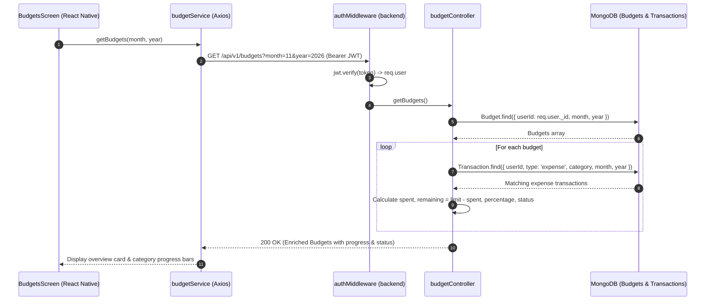
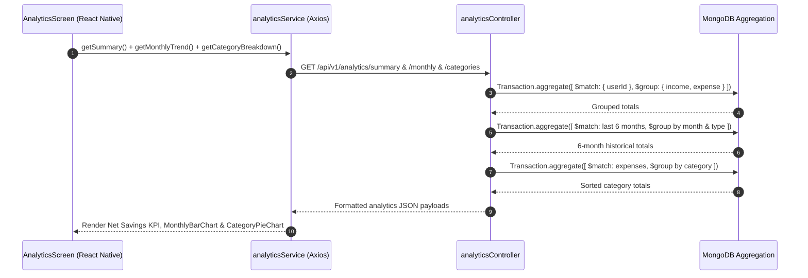
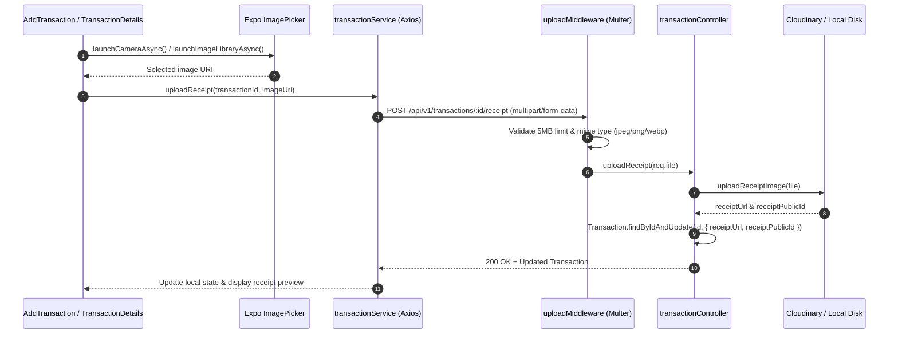
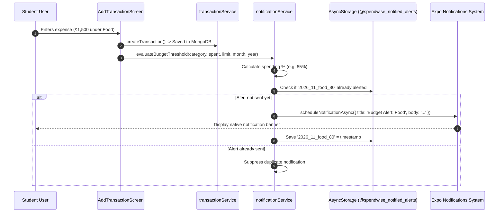

# SpendWise – Project Architecture

This document describes the architectural layout, directory responsibilities, component hierarchy, navigation design, and design philosophies of **SpendWise – Personal Expense Tracker**.

---

## 1. Directory Structure

```text
SpendWise/
│
├── assets/                  # Static assets: images, app icons, and fonts
│   ├── images/
│   ├── icons/
│   └── fonts/
│
├── src/                     # Application source code
│   ├── components/          # Reusable UI components (Button, Input, Card, etc.)
│   ├── screens/             # Screen components (Login, Register, ForgotPassword)
│   ├── navigation/          # React Navigation navigators (AuthNavigator, AppNavigator)
│   ├── services/            # API services and networking (Future phases)
│   ├── context/             # Global React Context providers (Auth, Expense) (Future phases)
│   ├── hooks/               # Custom React hooks (Future phases)
│   ├── constants/           # App-wide constants (routes, strings)
│   ├── utils/               # Helper and validation utilities
│   └── styles/              # Theme, colors, typography, and global styles
│
├── docs/                    # Architectural, phase tracking, and viva notes
│   ├── DEVELOPMENT_NOTES.md
│   ├── PROJECT_ARCHITECTURE.md
│   └── PHASE_TRACKER.md
│
├── App.js                   # Root entry point initializing navigation and providers
├── app.json                 # Expo configuration (app metadata, icons, orientation)
├── package.json             # NPM project manifest & dependencies
└── .gitignore               # Git ignored directories (node_modules, .expo, etc.)
```

---

## 2. Directory Responsibilities

| Directory | Purpose & Responsibility |
|---|---|
| `assets/` | Holds static images, splash screens, vector icons, and custom fonts. |
| `src/components/` | Reusable presentational components (dumb/pure components) that receive props and trigger callbacks without direct coupling to business logic. |
| `src/screens/` | Full-screen components representing pages in the application stack (e.g., `LoginScreen`, `RegisterScreen`, `ForgotPasswordScreen`). Responsible for screen-level state and form handling. |
| `src/navigation/` | Configures React Navigation stack, tab, and drawer navigators, defining route names and transition behavior. |
| `src/styles/` | Houses the centralized design system (`theme.js`), ensuring consistent color palettes, typography scales, spacing units, and border radiuses. |
| `src/utils/` | Reusable pure JavaScript utility functions such as input validators, currency formatters, and date parsers. |
| `src/constants/` | Constant definitions like navigation route names (`ROUTES`) to avoid typos in string literals. |
| `docs/` | Comprehensive technical notes, viva preparation guides, and milestone progress trackers. |

---

## 3. Component Architecture & Principles

1. **Separation of Concerns:**
   - Presentational components (`Button`, `Input`, `Card`, `ScreenContainer`) handle only visual styling and interaction feedback.
   - Screen components manage user input, validation logic, and navigation calls.
2. **Centralized Theming:**
   - All components pull styling rules (colors, padding, font sizes) from `src/styles/theme.js`.
   - No hardcoded hex values or arbitrary margin/padding values are scattered across screens.
3. **Pure JavaScript & Beginner-Friendly Code:**
   - Standard React functional components and standard hooks (`useState`, `useCallback`).
   - Clean, readable variable names and explicit comments in simple Hinglish for viva presentation.

---

## 4. Screen Organization & Navigation Structure (Phases 1–5)

The app utilizes a composite navigation architecture combining React Navigation **Native Stack** and **Bottom Tabs**:

```text
NavigationContainer
└── Root Stack Navigator
    ├── Auth Stack
    │   ├── LoginScreen ("Login")
    │   ├── RegisterScreen ("Register")
    │   └── ForgotPasswordScreen ("ForgotPassword")
    │
    ├── MainApp (Bottom Tab Navigator)
    │   ├── Home ("DashboardScreen")
    │   ├── Transactions ("TransactionsScreen")
    │   ├── Budgets ("BudgetsPlaceholderScreen")
    │   └── Profile ("ProfilePlaceholderScreen")
    │
    ├── Transaction Modals & Screens
    │   ├── AddTransactionScreen ("AddTransaction")
    │   ├── EditTransactionScreen ("EditTransaction")
    │   └── TransactionDetailsScreen ("TransactionDetails")
    │
    └── DesignSystemPreviewScreen ("DesignSystemPreview")
```

---

## 5. Backend Architecture (Phases 6–7)

The backend follows the industry-standard **MVC (Model-View-Controller)** pattern with verified JWT authentication:

```text
backend/
├── src/
│   ├── config/db.js                  # Mongoose MongoDB connection pool
│   ├── models/                       # Mongoose Schemas & Data validation
│   │   ├── User.js                   # Bcrypt hashed credentials, currency, matchPassword
│   │   ├── Transaction.js            # Income/Expense amounts, categories, receiptUrl, receiptPublicId
│   │   └── Budget.js                 # Monthly category limit targets & compound unique index
│   ├── controllers/                  # Business logic & request handling
│   │   ├── authController.js         # Register, Login, getMe, updateProfile, changePassword
│   │   ├── transactionController.js  # Scoped CRUD (req.user._id), receipt upload & removal
│   │   ├── budgetController.js       # Budget CRUD & real-time MongoDB spending calculations
│   │   └── analyticsController.js    # Financial summaries, 6-month trends & category breakdown
│   ├── routes/                       # Express router endpoints
│   │   ├── authRoutes.js             # /api/v1/auth (public & protected)
│   │   ├── transactionRoutes.js      # /api/v1/transactions & /:id/receipt (protected)
│   │   ├── budgetRoutes.js           # /api/v1/budgets & /summary (protected)
│   │   └── analyticsRoutes.js        # /api/v1/analytics/summary, /monthly, /categories (protected)
│   ├── middleware/                   # Express middlewares
│   │   ├── authMiddleware.js         # JWT Bearer token verification & req.user binding
│   │   ├── uploadMiddleware.js       # Multer multipart form-data parser & 5MB file validator
│   │   └── errorMiddleware.js        # 404 & Centralized error handler
│   ├── utils/
│   │   ├── generateToken.js          # Signs HMAC SHA-256 JWT tokens with expiry
│   │   └── receiptUploader.js        # Cloudinary uploader with local disk fallback
│   ├── app.js                        # Express app, static /uploads route & middlewares
│   └── server.js                     # HTTP server listener (0.0.0.0) & graceful shutdown
└── test/
    ├── api.test.js                   # Automated transaction CRUD tests (11/11 passed)
    ├── auth.test.js                  # Automated auth & security tests (14/14 passed)
    ├── budget.test.js                # Automated budget management tests (15/15 passed)
    └── analytics.test.js             # Automated analytics & receipt tests (8/8 passed)
```

---

## 6. Frontend Networking, State & Native Architecture (Phases 8–10)

The frontend integrates a modular 4-tier networking, state, and native features pipeline:

```text
src/
├── constants/
│   ├── api.js                       # API_BASE_URL (Metro auto-detect / LAN IP) & STORAGE_KEYS
│   └── routes.js                    # ROUTES: Home, Transactions, Budgets, Analytics, Profile
├── components/
│   └── charts/
│       ├── MonthlyBarChart.js       # 6-Month Income vs Expense comparison bar chart
│       └── CategoryPieChart.js      # SVG Category Donut chart & itemized percentage list
├── services/
│   ├── api.js                       # Axios instance with request/response interceptors
│   ├── authService.js               # Auth HTTP endpoints & token memory cache
│   ├── transactionService.js        # Transaction CRUD & multipart receipt photo upload
│   ├── budgetService.js             # Budget CRUD & monthly summary endpoints
│   ├── analyticsService.js          # Financial KPIs, 6-month cashflow trends & categories
│   └── notificationService.js       # Expo Notifications & duplicate alert suppression
├── context/
│   ├── AuthContext.js               # Authentication state, login/register/logout, AsyncStorage
│   └── TransactionContext.js        # Transactions state, live MongoDB sync, derived metrics
└── screens/
    ├── DashboardScreen.js           # Balance, summary, recent transactions, monthly budget widget
    ├── TransactionsScreen.js        # FlatList, search, filter chips, pull-to-refresh
    ├── BudgetsScreen.js             # Monthly overview card, category budget cards, progress bars
    ├── AnalyticsScreen.js           # Net savings KPI, 6-month trend chart, category donut chart
    ├── AddTransactionScreen.js      # Form validation, receipt camera/gallery, budget alert triggers
    ├── EditTransactionScreen.js     # Update record, budget alert triggers
    ├── TransactionDetailsScreen.js  # Details view, receipt preview with pinch modal, delete
    └── ProfilePlaceholderScreen.js  # Profile view/edit, password change, notification toggle, sign out
```

---

## 7. End-to-End Data & Flow Diagrams

### Flow A: Budget Screen Data Flow


### Flow B: Analytics Screen Data Flow


### Flow C: Receipt Photo Upload Pipeline


### Flow D: Local Budget Warning Notification Flow


### Flow E: End-to-End Multi-User Security & Authorization Architecture
```mermaid
sequenceDiagram
    autonumber
    participant Client as React Native App (SpendWise)
    participant Axios as Axios API Client (with Bearer Interceptor)
    participant Router as Express.js Router (/api/v1/*)
    participant AuthMid as authMiddleware (verifyToken)
    participant Ctrl as Resource Controller (tx / budget / analytics)
    participant Model as Mongoose Model (User / Tx / Budget)
    participant DB as MongoDB Database

    Client->>Axios: api.get('/transactions')
    Axios->>Axios: Attach Header 'Authorization: Bearer <JWT_TOKEN>'
    Axios->>Router: HTTP GET /api/v1/transactions
    Router->>AuthMid: protect(req, res, next)
    AuthMid->>AuthMid: jwt.verify(token, JWT_SECRET)
    alt Token Invalid or Expired
        AuthMid-->>Client: 401 Unauthorized ("Token invalid or expired")
    else Token Valid
        AuthMid->>Model: User.findById(decoded.id)
        Model-->>AuthMid: Authenticated User Object
        AuthMid->>Router: req.user = user; next()
        Router->>Ctrl: getTransactions(req, res)
        Ctrl->>Model: Transaction.find({ userId: req.user._id })
        Note over Ctrl,Model: Strict Multi-User Isolation: Scoped strictly by req.user._id
        Model->>DB: BSON Query with indexed { userId }
        DB-->>Model: User's Private Records Only
        Model-->>Ctrl: Array of Transactions
        Ctrl-->>Client: 200 OK + JSON Data Payload
    end
```

---

## 8. Scope Boundaries Summary

- **Phases 1–3:** Complete Authentication UI & Design System.
- **Phases 4–5:** Main Tab Navigation, Dashboard, Transaction List with Search & Filters, Add/Edit/Delete CRUD forms, and React Context state.
- **Phase 6:** Express.js REST API, MongoDB connection, User/Transaction/Budget Mongoose models, and verified transaction endpoints.
- **Phase 7:** Backend Authentication & Security: bcrypt password hashing, JWT token generation, `authMiddleware`, `authRoutes`, user isolation (preventing cross-user access), and 14/14 automated tests.
- **Phase 8:** Mobile API & Context Integration: Axios client with Bearer token interceptor, AsyncStorage persistent session restore, `AuthContext`, `TransactionContext` live MongoDB sync, pull-to-refresh on FlatLists, and full CRUD screen wiring.
- **Phase 9:** Advanced Budget Management: MongoDB budget CRUD endpoints, real-time monthly expense matching, 80% & 100% status thresholds, `BudgetsScreen` with overview card and category progress bars, and 15/15 automated tests.
- **Phase 10:** Analytics & Native Features: MongoDB aggregation analytics (`/summary`, `/monthly`, `/categories`), 6-month cashflow trend bar chart, category segmented distribution chart, receipt photo capture and upload with Cloudinary/local fallback, local budget threshold notifications with duplicate prevention, and 8/8 automated tests.
- **Phase 11 (Completed):** Profile Management & Settings, Change Password, Dynamic Currency Selection (`INR`, `USD`, `EUR`, `GBP`), Multi-User Security & Isolation Testing (19/19 tests), Backend Health Check & Production Readiness (`render.yaml`), Frontend App Configuration (`app.json`, `eas.json`), and Complete Documentation.
- **Phase 12 (Future):** Final Production APK Generation, Google Drive Distribution, and Final College Submission (Strictly Not Started - Awaiting Explicit Approval).
